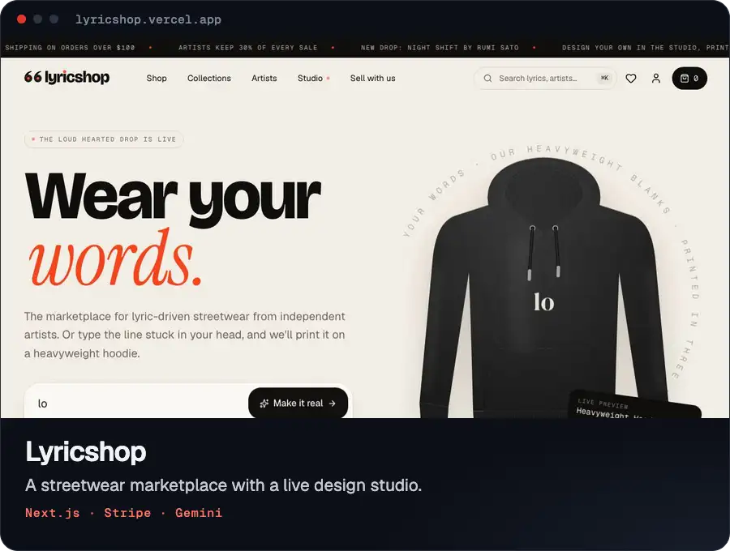

# Lyricshop — wear your words

A complete storefront and marketplace for **Lyricshop**, a clothing brand built on lyrics: independent artists sell
streetwear printed with their lines, and shoppers can design their own pieces in the **Lyricshop Studio**.

Live: https://lyricshop.vercel.app



## Run it

```bash
npm install
npm run dev
```

Open http://localhost:3000.

| Script              | What it does                                                          |
| ------------------- | --------------------------------------------------------------------- |
| `npm run dev`       | Dev server (Turbopack)                                                |
| `npm run build`     | Production build                                                      |
| `npm run typecheck` | Regenerates route types and runs `tsc`                                |
| `npm run lint`      | ESLint                                                                |
| `npm run brand`     | Rebuilds the logo files in `public/brand/` from `scripts/build-brand.mjs` |
| `npm run fonts`     | Re-downloads the Studio's design fonts into `public/fonts/design/`    |

## Connect Nano Banana Pro (AI graphics + photoshoots)

The Studio's **AI** panel generates print-ready graphics and "see it worn" photos with **Nano Banana Pro**
(Gemini 3 Pro Image). Add your Gemini API key to `.env.local` and restart the dev server:

```bash
GEMINI_API_KEY=your-key
# optional: override the model id (defaults to gemini-3-pro-image, falls back to gemini-3-pro-image-preview)
GEMINI_IMAGE_MODEL=gemini-3-pro-image
```

Without a key everything else works; the AI panel explains how to connect it. The key never reaches the browser —
requests go through `src/app/api/generate` and `src/app/api/photoshoot`, which are rate-limited per visitor.

The site's campaign, collection, lookbook and artist photography in `public/images/` was generated with
Nano Banana Pro in Google Flow.

## Payments

Checkout runs in **demo mode** by default (orders are stored on the device, no payment is taken). Set
`STRIPE_SECRET_KEY` in `.env.local` to send shoppers to Stripe Checkout instead. Prices are always recomputed on the
server from the catalog, never trusted from the browser. See `.env.local.example`.

## What's inside

- **Storefront** — home, shop with filters/sort/search, product pages (color/size, zoom, back views, lifestyle shots,
  structured data), collections, artist storefronts, ⌘K search that also searches lyrics, wishlist, bag drawer,
  cart, multi-step checkout, order confirmation and an account area (orders, saved designs, wishlist, following).
- **Marketplace** — artist directory and shops, a "Sell with us" page with an earnings calculator, and a demo
  artist dashboard.
- **Studio** — hoodies, tees, crewnecks, long sleeves, totes and caps in 14 colorways; front and back prints;
  22 typefaces with curved text and outlines; one-click lyric layouts; a sticker library; uploads with automatic
  background removal; layers, undo/redo, snapping guides and keyboard shortcuts; Nano Banana Pro graphics and
  photoshoots; mockup and 3600 px print-file export; saving and add to bag.
- **Brand** — the logo (a quotation mark made of two records, plus the "lyricshop" wordmark with a red on-air dot)
  is pure vector, generated from `scripts/build-brand.mjs`. Guidelines live at `/brand`.

### Code map

```
src/app/(store)/        storefront routes (shared header/footer)
src/app/studio/         the full-screen Studio
src/app/checkout/       checkout flow (minimal chrome)
src/app/api/            generate, photoshoot, checkout
src/components/         UI by area (garment renderer, studio, product, cart, layout…)
src/lib/garments.ts     vector garment blanks and print areas
src/lib/design.ts       the print-design model shared by catalog products and the Studio
src/lib/data/           demo catalog: products, artists, collections
src/lib/store/          cart, library (wishlist, designs, orders) and UI state
```

## Before launch

The catalog, artists, ratings, sales figures and dashboard numbers are **demo content**. Replace them with real
data (or wire `src/lib/data` to your CMS/database), swap the template legal copy on `/help`, and connect real
payments, order fulfilment and email.
